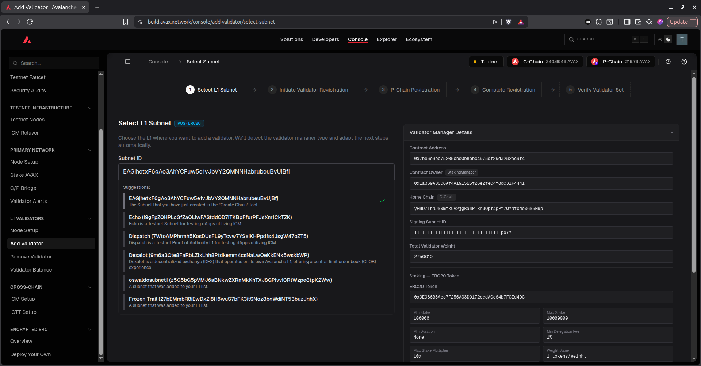
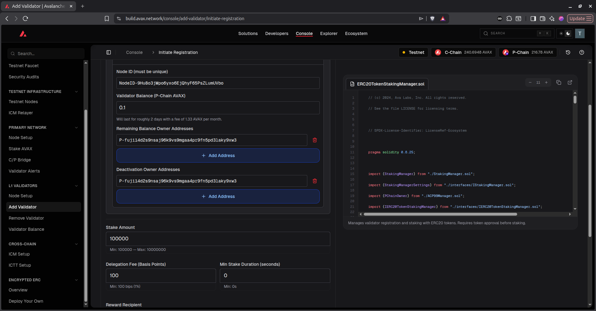
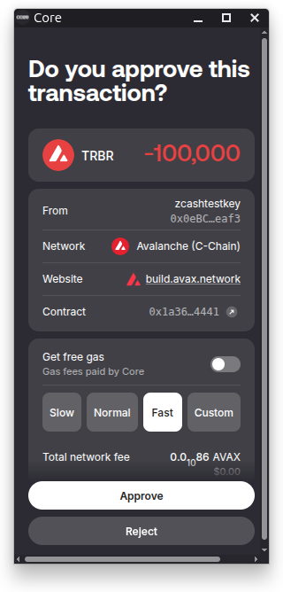
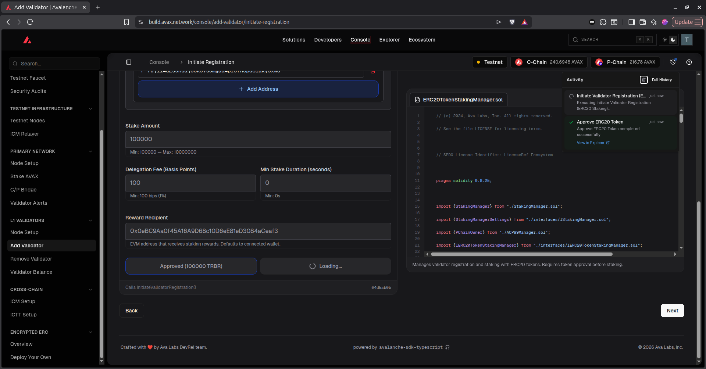
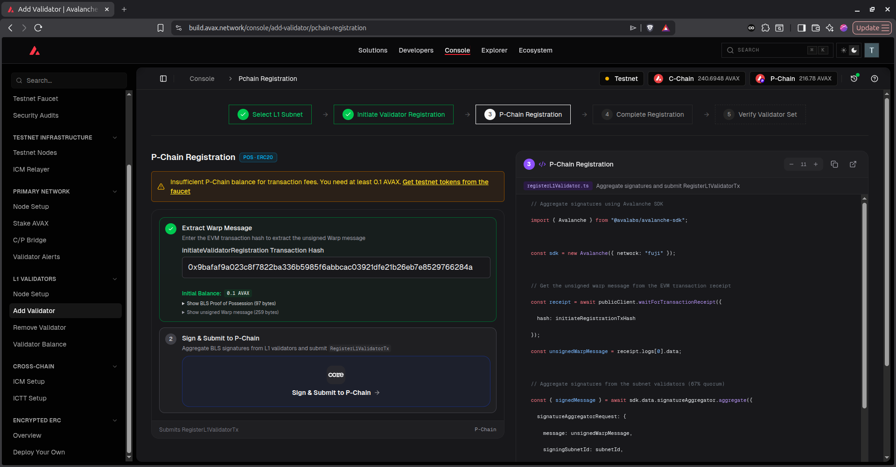
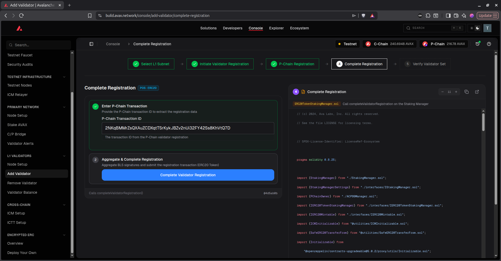

# Running a redbridge-oracle validator with Docker

This guide is the quickest way to get a `redbridge-oracle` validator node up. You
don't need to clone the repo or build anything. You'll install Docker, start a
Zcash node (Zebra), and then start our prebuilt node image. The commands below
use our default paths, so in most cases you can copy them as they are.

If you need more control (a non-Docker install, custom AvalancheGo flags,
mainnet), read [DEPLOYMENT.md](DEPLOYMENT.md) instead. All the image options
are documented in [docker/README.md](docker/README.md).

## Overview

When you're finished, your server will run two containers:

```
┌────────────────────────── Your server ───────────────────────────┐
│                                                                  │
│   Docker container "zebra"          Docker container             │
│   Zcash node — keeps a    ◀──────   "redbridge-oracle"           │
│   copy of the Zcash       reads      AvalancheGo + the           │
│   blockchain              blocks     redbridge-oracle VM         │
│   (port 8233 public,                 (port 9651 public,          │
│    port 8232 private)                 port 9650 private)         │
└──────────────────────────────────────────────────────────────────┘
```

- `redbridge-oracle` is AvalancheGo (the Avalanche node software) with our VM
  plugin installed. It joins the Avalanche Fuji testnet and validates the
  redbridge-oracle L1, which is a separate chain that stores Zcash block data.
- `zebra` is a Zcash Mainnet node. Your validator uses it to check Zcash block
  data proposed by other validators, so it doesn't have to trust them.

These IDs come up later in the guide. The image already has them built in, so
the only time you'll need to type one is when you register as a validator in
step 6.

| | |
|---|---|
| Avalanche network | `fuji` (testnet) |
| Subnet (L1) ID | `EAGjhetxF6gAo3AhYCFuw5e1vJbVY2QMNNHabrubeuBvUjBfj` |
| Blockchain ID | `8iARaBqk63EqdbRu7KLu348JkfyFHgw2JkbfsbMWK2r9JE2Dq` |
| VM ID | `sP6SrkPy8HGHCqRwuxuvCPPUKSxLX5hZtozvNPQxFsLfAZgiT` |
| Zcash network | Mainnet |
| Docker image | `reddev2020/redbridge-oracle-node:v1.0.0-fuji` |

### Default paths and ports

We keep all the large data on a separate data disk mounted at `/mnt/blockstorage`:

- Zebra chain data: `/mnt/blockstorage/.zebra/data`
- Zebra config: `/mnt/blockstorage/zebra/config/zebrad.toml`
- Node data, including your validator keys: `/mnt/blockstorage/.avalanchego-node1`
- Staking key backup: `~/redbridge-staking-backup` (copy this off the server
  afterwards)

Public ports are `9651/tcp` (Avalanche P2P) and `8233/tcp` (Zcash P2P). The
RPC ports, `9650` (Avalanche) and `8232` (Zcash), are only reachable from the
server itself. The node reaches Zebra at `http://host.docker.internal:8232`
with no username or password.

If your data disk is mounted at a different path, set that path in step 1.3.
All the later commands use `$STORAGE_DIR`.

## Requirements

- A server with at least 8 vCPU, 16 GB RAM and a 1 TB NVMe SSD. We recommend 16
  vCPU, 32 GB RAM and 2 TB. It must be x86_64.
- Ubuntu 26.04 LTS. 24.04 and 22.04 also work.
- A static public IP, so the other validators can always reach you at the same
  address.
- A data disk mounted at `/mnt/blockstorage` (or another path) with well over
  1 TB free.
- Inbound 9651/tcp and 8233/tcp open to the internet. If your cloud provider
  has its own firewall or security group, open them there too.
- Some patience. Zebra's first sync can take a day or more, and the Fuji sync
  takes a few hours.
- The Core wallet browser extension, installed from
  <a href="https://core.app/" target="_blank" rel="noopener noreferrer">core.app</a>.
  You use it to register (step 6) and remove (step 7) your validator, so set up
  an account and turn on Testnet in its settings before you start.
- Some AVAX on both chains in your Core wallet. You need at least 0.5 AVAX on
  the P-Chain for the registration fee and the validator balance. You also need
  a little on the C-Chain for gas when you approve, register and remove your
  validator. On Fuji, you can get test AVAX from the faucet.
- 100,000 RBR tokens on the C-Chain in the same Core wallet. This is your stake.
  You only need the AVAX and RBR when you register as a validator (step 6).

> **Note:** To get the 100,000 RBR for your stake, contact the red.dev team
> before you start step 6.

## 1. Prepare the server

### 1.1 Update packages

We use `curl` to call the node APIs and `jq` to format the JSON output.

```bash
sudo apt install -y curl jq
```

### 1.2 Install Docker

This uses Docker's official install script:

```bash
curl -fsSL https://get.docker.com | sudo sh
sudo systemctl enable --now docker
sudo docker --version
```

The last command should print `Docker version 2x.x.x, build ...`. In this guide
we run every `docker` command with `sudo`.

### 1.3 Point to the data disk

```bash
export STORAGE_DIR=/mnt/blockstorage
echo "export STORAGE_DIR=$STORAGE_DIR" >> ~/.bashrc
df -h "$STORAGE_DIR"
```

Don't skip the `.bashrc` line. If you open a new terminal and `$STORAGE_DIR`
isn't set, the data ends up on the OS disk.

### 1.4 Firewall (ufw)

```bash
sudo ufw allow 9651/tcp
sudo ufw allow 8233/tcp
sudo ufw allow in on docker0 to 172.17.0.1 port 8232 proto tcp
```

You need the third rule so the node container can reach Zebra's RPC over the
Docker bridge. It doesn't expose 8232 to the internet. Without it, ufw silently
drops the traffic, and the node fails with `context deadline exceeded` when it
calls Zebra.

You also need to open 9651 and 8233 in your cloud provider's firewall. Never
open 9650 or 8232 there.

## 2. Set up Zebra

Every validator checks every block. If another validator proposes "Zcash block
1000 has hash X", your node fetches block 1000 from its own Zcash node and
compares the two. If your node can't reach Zcash, AvalancheGo still starts and
looks healthy, but it rejects every block, so it can't validate. This is the
most common setup mistake.

We run Zebra in Docker on the same server. It needs about 300 GB of disk.

### 2.1 Create the folders

The Zebra image runs as UID `10001`, so that user has to own the folders:

```bash
sudo mkdir -p $STORAGE_DIR/.zebra/data $STORAGE_DIR/zebra/config
sudo chown -R 10001:10001 $STORAGE_DIR/.zebra $STORAGE_DIR/zebra
```

### 2.2 Write zebrad.toml

```bash
sudo tee $STORAGE_DIR/zebra/config/zebrad.toml > /dev/null <<'TOML'
[network]
network = "Mainnet"
listen_addr = "0.0.0.0:8233"            # Zcash P2P — open 8233/tcp to the internet

[state]
cache_dir = "/var/cache/zebrad-cache"   # matches the data volume mount below

[rpc]
# Listen on all interfaces *inside the Zebra container*; who can reach it from
# outside is decided by the -p mapping in step 2.3.
listen_addr = "0.0.0.0:8232"
# Zebra 2.x turns on cookie authentication by default. The redbridge-oracle VM
# can't use Zebra's cookie file, so turn it off. Port 8232 is only published on
# the private Docker bridge, so it is never reachable from the internet.
enable_cookie_auth = false
TOML
sudo chown 10001:10001 $STORAGE_DIR/zebra/config/zebrad.toml
```

### 2.3 Start Zebra

```bash
sudo docker run -d --name zebra \
  -p 8233:8233 \
  -p 172.17.0.1:8232:8232 \
  -v $STORAGE_DIR/.zebra/data:/var/cache/zebrad-cache \
  -v $STORAGE_DIR/zebra/config:/home/zebra/.config \
  --restart unless-stopped \
  zfnd/zebra:latest
```

Port 8233 is the public P2P port. Zebra uses it to find peers. The RPC port,
8232, is only published on the Docker bridge address (`172.17.0.1`), so our
node container can reach it but nothing on the internet can. The two volumes
keep the chain data and the config from step 2.2.

Don't change this to a plain `-p 8232:8232`. Docker's port rules bypass ufw, so
that would put the RPC on the internet. If your bridge has a different address
(check with `ip -4 addr show docker0`), use that address instead.

### 2.4 Wait for the sync

The first sync takes anywhere from several hours to a couple of days. You can
follow it in the logs. It's done when `sync_percent` gets close to 100%. Ctrl-C
stops the log output, and Zebra keeps running.

```bash
sudo docker logs -f zebra
```

### 2.5 Check the RPC

```bash
curl -s -X POST --data '{"jsonrpc":"2.0","id":1,"method":"getblockcount","params":[]}' \
  -H 'content-type:application/json' http://172.17.0.1:8232 | jq
```

The response should look like this:

```json
{
  "jsonrpc": "2.0",
  "id": 1,
  "result": 3517729
}
```

`result` is the latest block your node has. Once Zebra is synced, it should
match (or be very close to) the height on
<a href="https://mainnet.zcashexplorer.app/" target="_blank" rel="noopener noreferrer">mainnet.zcashexplorer.app</a>.

<details>
<summary>Other ways to run the Zcash node</summary>

Zebra on the same server, as described above, is the easiest setup. Some
alternatives:

- **Zebra on another server you control.** Set the endpoint to
  `http://<private-ip>:8232` and keep 8232 behind a firewall or VPN.
- **zcashd.** This works because the VM only calls `getblockcount`,
  `getblockhash` and `getblock`. However, zcashd is being retired, so we
  recommend Zebra.
- **A third-party public Zcash RPC.** We don't recommend this, because your node
  would be trusting their data instead of checking it itself.
- **`mock-zcashd` from this repo.** This is for local testing only. A validator
  that uses it rejects every real block.

See the Zebra docs at <a href="https://zebra.zfnd.org/" target="_blank" rel="noopener noreferrer">zebra.zfnd.org</a>.

</details>

## 3. Start the redbridge-oracle node

Create the data folder. This folder holds the chain database and your validator
keys:

```bash
sudo mkdir -p $STORAGE_DIR/.avalanchego-node1
```

Pull the image and start the node:

```bash
sudo docker pull reddev2020/redbridge-oracle-node:v1.0.0-fuji

sudo docker run -d --name redbridge-oracle \
  --add-host=host.docker.internal:host-gateway \
  -e ZCASH_RPC_ENDPOINT=http://host.docker.internal:8232 \
  -p 9651:9651 \
  -p 127.0.0.1:9650:9650 \
  -v $STORAGE_DIR/.avalanchego-node1:/root/.avalanchego \
  --restart unless-stopped \
  reddev2020/redbridge-oracle-node:v1.0.0-fuji
```

A few notes on these flags:

- `--add-host=host.docker.internal:host-gateway` lets the container reach Zebra
  on the host. `ZCASH_RPC_ENDPOINT` points to it.
- `9651` is the staking/P2P port. Other validators connect to you on this port,
  so it has to be public.
- `9650` is the RPC port. It's bound to `127.0.0.1` and must stay private. If
  you want to serve RPC publicly, put an authenticated reverse proxy in front of
  it (see [`security/deployment-notes.md`](../security/deployment-notes.md)).
- The volume holds the chain data and your validator keys, so they survive
  restarts and upgrades.
- The `-fuji` tag means the node joins the Fuji testnet.

The image already includes the network, subnet ID, blockchain ID and VM plugin.

Don't set the Zcash endpoint to `http://127.0.0.1:8232`. Inside a container,
`127.0.0.1` is the container itself, not your server, so the node won't find
Zebra.

### Zcash settings

The default Zebra setup only needs `ZCASH_RPC_ENDPOINT`. These are the other
settings, in case you need them:

- `ZCASH_RPC_ENDPOINT` (required). Set it to `http://host.docker.internal:8232`
  when Zebra runs on the same host. If Zebra runs on another server, use
  `http://<private-ip>:8232` and leave out `--add-host`.
- `ZCASH_RPC_USER` / `ZCASH_RPC_PASSWORD`. Set these only if your Zcash RPC
  requires a username and password. Pass them with `-e`.
- `ZCASH_CONFIRMATION_DEPTH` (default `24`). Blocks closer than this to the
  Zcash tip are refused. Leave it at 24, because all validators need to use the
  same value.

We also publish a `v1.0.0` tag (without `-fuji`), but redbridge-oracle isn't
deployed on Avalanche mainnet yet, so that image won't work for now.

If you already run an AvalancheGo node and want to use the same NodeID, follow
[docker/README.md → Using an existing node](docker/README.md#using-an-existing-node)
instead of the `docker run` command above.

## 4. Back up your validator keys

Do this right after the first start. Your node's identity is stored in the
`staking` folder (`staker.key`, `staker.crt`, `signer.key`). If you lose these
files, you lose your NodeID and have to register as a validator again.

```bash
sudo cp -a $STORAGE_DIR/.avalanchego-node1/staking ~/redbridge-staking-backup
```

Then copy `~/redbridge-staking-backup` off the server to somewhere safe. Treat
it like a password.

## 5. Check that it's working

### 5.1 Logs

```bash
sudo docker logs -f redbridge-oracle
```

Near the top of the logs you should see the entrypoint install the plugin and
write the chain config:

```
[entrypoint] installed VM plugin -> /root/.avalanchego/plugins/sP6SrkPy8HGHCqRwuxuvCPPUKSxLX5hZtozvNPQxFsLfAZgiT
[entrypoint] wrote VM chain config -> /root/.avalanchego/configs/chains/8iARaBqk63EqdbRu7KLu348JkfyFHgw2JkbfsbMWK2r9JE2Dq/config.json
```

### 5.2 Bootstrapping

On the first start, the node has to download Fuji, which takes a few hours. Run
this to check progress:

```bash
for chain in P X C 8iARaBqk63EqdbRu7KLu348JkfyFHgw2JkbfsbMWK2r9JE2Dq; do
  printf '%-52s ' "$chain"
  curl -s -X POST --data "{\"jsonrpc\":\"2.0\",\"id\":1,\"method\":\"info.isBootstrapped\",\"params\":{\"chain\":\"$chain\"}}" \
    -H 'content-type:application/json' http://127.0.0.1:9650/ext/info | jq -c '.result // .error'
done
```

The node is ready once all four chains (P, X, C and the redbridge-oracle chain,
`8iARaBqk…`) return `{"isBootstrapped":true}`.

### 5.3 Query the chain

This gets the latest block:

```bash
curl -s -X POST --data '{"jsonrpc":"2.0","id":1,"method":"zavax.getBlock","params":{}}' \
  -H 'content-type:application/json' \
  http://127.0.0.1:9650/ext/bc/8iARaBqk63EqdbRu7KLu348JkfyFHgw2JkbfsbMWK2r9JE2Dq/rpc | jq
```

If the response contains Zcash block data (`"data": { "hash": ..., "height": ... }`),
the chain is working. A `not_found` or `pending` status also means the chain is
working. It just means that height hasn't been bridged yet.

## 6. Join as a validator

Wait until all four chains have bootstrapped (5.2). Then make sure you have:

- **AVAX on the P-Chain.** Registering a validator is a P-Chain transaction. Your Core wallet
  pays the fee and also funds the validator's balance. An L1 validator
  pays a small continuous fee from that balance, and if the balance runs out,
  the validator goes inactive. AVAX on the C-Chain doesn't count, so move it to
  the P-Chain first. On Fuji, you can get test AVAX from the faucet.
- **100,000 RBR.** This is the stake. Contact the red.dev team to get it
  before you register.

### 1. Get your node ID and BLS key

```bash
curl -s -X POST --data '{"jsonrpc":"2.0","id":1,"method":"info.getNodeID"}' \
  -H 'content-type:application/json' http://127.0.0.1:9650/ext/info | jq
```

You need three values from the response: `nodeID` (for example
`NodeID-7Xhw2mDxuDS44j42TCB6U5579esbSt3Lg`), `nodePOP.publicKey` and
`nodePOP.proofOfPossession`.

### 2. Register in the Builder Console

Open
<a href="https://build.avax.network/console/add-validator/" target="_blank" rel="noopener noreferrer">build.avax.network/console/add-validator</a>
and connect your Core wallet with Testnet turned on. Your Core wallet
needs the RBR on the C-Chain and AVAX on the P-Chain. The registration takes
four screens.

**2a. Select the L1 subnet.** Enter the subnet ID
`EAGjhetxF6gAo3AhYCFuw5e1vJbVY2QMNNHabrubeuBvUjBfj`. The console should
detect a PoS · ERC20 validator manager with a minimum stake of 100,000 and a
minimum delegation fee of 1%. Click **Next**.



**2b. Initiate validator registration.** Fill in the form:

| Field | Value |
|---|---|
| Node ID | `nodeID` from step 1 |
| BLS public key / proof of possession | `nodePOP.publicKey` / `nodePOP.proofOfPossession` from step 1 |
| Validator Balance | P-Chain AVAX for the continuous fee. `0.1` lasts about 2 days at ~1.33 AVAX/month, so add more if you plan to run longer |
| Remaining Balance / Deactivation Owner | Your P-Chain address (pre-filled) |
| Stake Amount | `100000` |
| Delegation Fee (bps) | `100` (1%, the minimum) |
| Min Stake Duration | `0` |
| Reward Recipient | EVM address that receives the rewards (defaults to your Core wallet address) |



Click **Approve** first. Your Core wallet asks you to let the staking manager spend
100,000 RBR. Confirm it.



When the button changes to **Approved (100000 TRBR)**, click **Initiate
Validator Registration**, confirm that transaction too, and then click
**Next**.



**2c. Sign and submit to the P-Chain.** The console fills in the transaction hash from the
previous screen and extracts the Warp message from it. Before you continue,
make sure you have at least 0.5 AVAX on the P-Chain. If you don't, you'll get
*"Insufficient P-Chain balance for transaction fees"*. In that case, move some
AVAX over with the **C/P Bridge** tool in the left menu, or use the faucet.
Then click **Sign & Submit to P-Chain**. The console collects BLS signatures
from the L1 validators and submits the `RegisterL1ValidatorTx`.



**2d. Complete validator registration.** The P-Chain transaction ID is already filled in.
Click **Complete Validator Registration** and confirm. This calls
`completeValidatorRegistration()` on the staking manager.



You don't need approval from the L1 owner to join as a validator. Anyone with
100,000 RBR and enough P-Chain AVAX can join the redbridge-oracle L1 as a
validator.

### 3. Confirm

subnet ID
`EAGjhetxF6gAo3AhYCFuw5e1vJbVY2QMNNHabrubeuBvUjBfj`

```bash
curl -s -X POST --data '{"jsonrpc":"2.0","id":1,"method":"platform.getCurrentValidators","params":{"subnetID":"EAGjhetxF6gAo3AhYCFuw5e1vJbVY2QMNNHabrubeuBvUjBfj"}}' \
  -H 'content-type:application/json' http://127.0.0.1:9650/ext/bc/P | jq
```

Your `nodeID` should appear in the list.

## 7. Remove validator (Leave the L1)

Removing a validator returns the 100,000 RBR stake. You do it with the same kind
of console flow at
<a href="https://build.avax.network/console/remove-validator/select-subnet" target="_blank" rel="noopener noreferrer">build.avax.network/console/remove-validator</a>.

Keep the node running until the last step finishes, because the console needs
signatures from the L1 validators along the way.

Connect your Core wallet with the account you registered with (Testnet on), then:

1. Enter the subnet ID `EAGjhetxF6gAo3AhYCFuw5e1vJbVY2QMNNHabrubeuBvUjBfj` and
   pick your validator by `nodeID`.
2. Initiate the removal and confirm the transaction. This starts the removal on
   the C-Chain staking manager.
3. Sign and submit the P-Chain transaction. You'll need a little P-Chain AVAX
   for the fee.
4. Complete the removal. Your RBR and any rewards go back to your Core wallet. Any
   unused validator balance on the P-Chain goes to the Remaining Balance Owner
   address you set when you registered.

Run the same `platform.getCurrentValidators` call from step 6. Your `nodeID`
should no longer be in the list. After that you can stop the node. If you might
rejoin later with the same NodeID, keep the key backup from step 4.

## 8. Day-to-day commands

```bash
sudo docker ps --filter name=redbridge-oracle   # is it running?
sudo docker logs -f redbridge-oracle            # follow logs (Ctrl-C to stop)
sudo docker stop redbridge-oracle
sudo docker start redbridge-oracle
sudo docker restart redbridge-oracle
sudo docker logs -f zebra                       # Zebra logs
```

## Troubleshooting

**`isBootstrapped` stays `false` for hours.** This is normal on the first start
while Fuji downloads. Follow the logs and wait.

**`zcash rpc error`, `connection refused`, or `getblockcount` errors in the
logs.** The node can't reach Zebra. Check that `ZCASH_RPC_ENDPOINT` isn't
`127.0.0.1`, that the `zebra` container is running and synced, and that the RPC
is published on `172.17.0.1:8232` (step 2.3).

**`context deadline exceeded (Client.Timeout exceeded while awaiting headers)`
for `host.docker.internal:8232`, followed by `FATAL ... shutting down chain`.**
ufw is dropping traffic from the container to Zebra. Running `curl` from the
host (step 2.5) still works, which hides the problem. To fix it, add the
`docker0` rule from step 1.4 and run `sudo docker restart redbridge-oracle`.

**`http status 401`.** Either Zebra cookie auth is on, or the Zcash
username/password is wrong. Set `enable_cookie_auth = false` (step 2.2), or fix
`ZCASH_RPC_USER`/`ZCASH_RPC_PASSWORD`.

**`-8` or "block height out of range" errors.** Zebra hasn't finished syncing
yet. Wait for it to catch up.

**Few or no peers.** Port 9651 is blocked. Open it in both ufw and your cloud
provider's firewall.

**P, X and C bootstrap but the redbridge-oracle chain doesn't.** The node can't
verify our blocks. This almost always means the Zcash node is unreachable or not
synced. Go back over step 2 and look for Zcash errors in the logs.

**`permission denied ... docker.sock`.** You ran `docker` without `sudo`.

**`jq: command not found`.** Run `sudo apt install -y jq`.

**Registration fails with insufficient funds.** You don't have enough AVAX on
the P-Chain. Move some over from the C-Chain and try again.

## Terms used in this guide

- **AvalancheGo**: the Avalanche node software.
- **Fuji**: Avalanche's public testnet.
- **P-Chain**: the Avalanche chain where validators are registered and their
  fees are paid.
- **L1 / subnet**: an independent chain on Avalanche with its own set of
  validators. redbridge-oracle is one.
- **VM**: the program that defines how a chain works. Ours copies Zcash block
  data.
- **Bootstrapping**: the node's first download of a chain.
- **NodeID / staking keys**: your node's permanent identity (`staker.key`,
  `signer.key`).

## Going further

This guide makes most of the choices for you. To change the data location, use
a Docker volume, change ports, see all the environment variables, upgrade, or
reuse an existing AvalancheGo node, see [docker/README.md](docker/README.md).
To build the image yourself, install with systemd instead of Docker, override
AvalancheGo flags, switch networks, or set up a production firewall and RPC
proxy, see [DEPLOYMENT.md](DEPLOYMENT.md).
